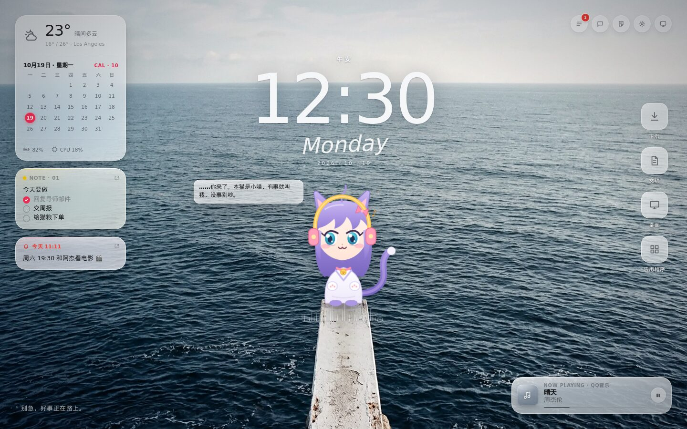
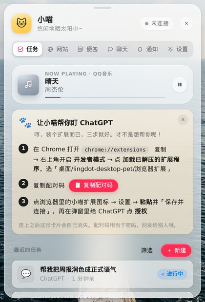
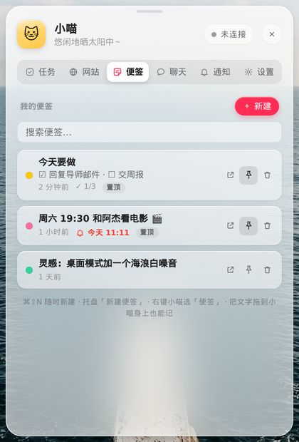
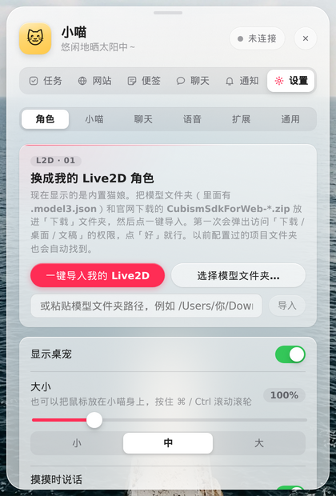
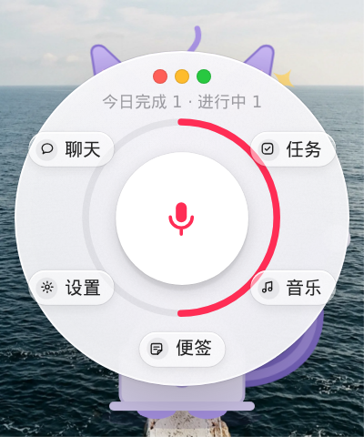
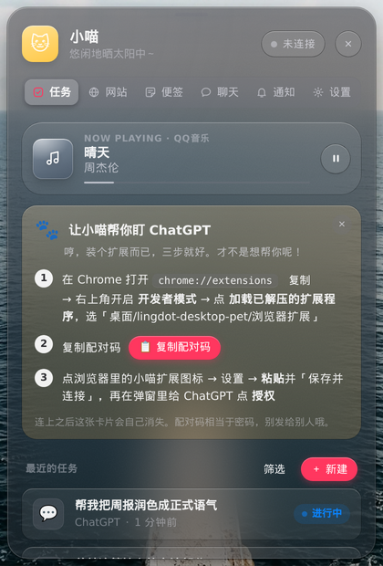
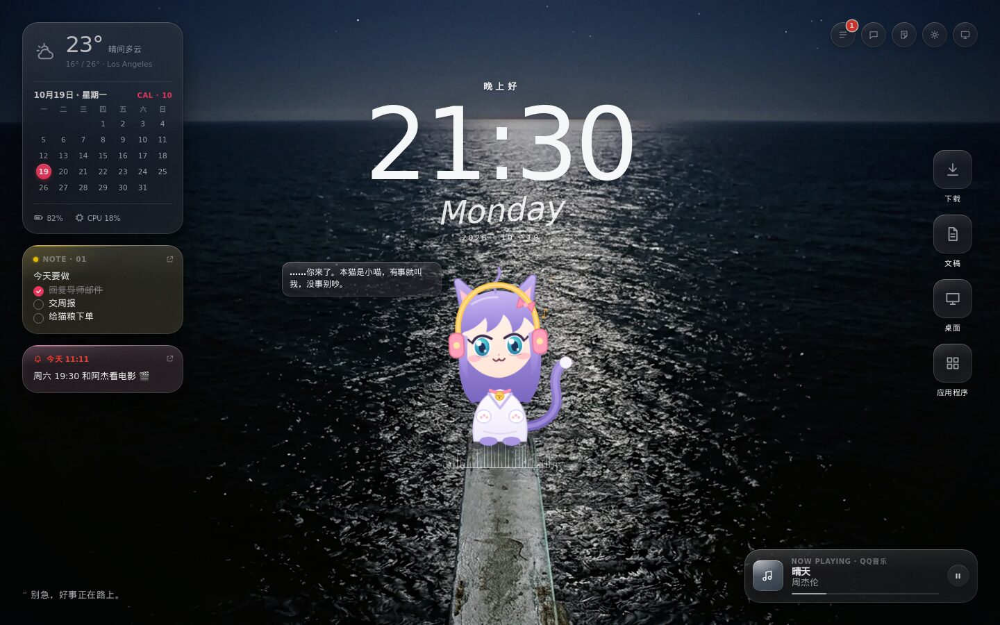
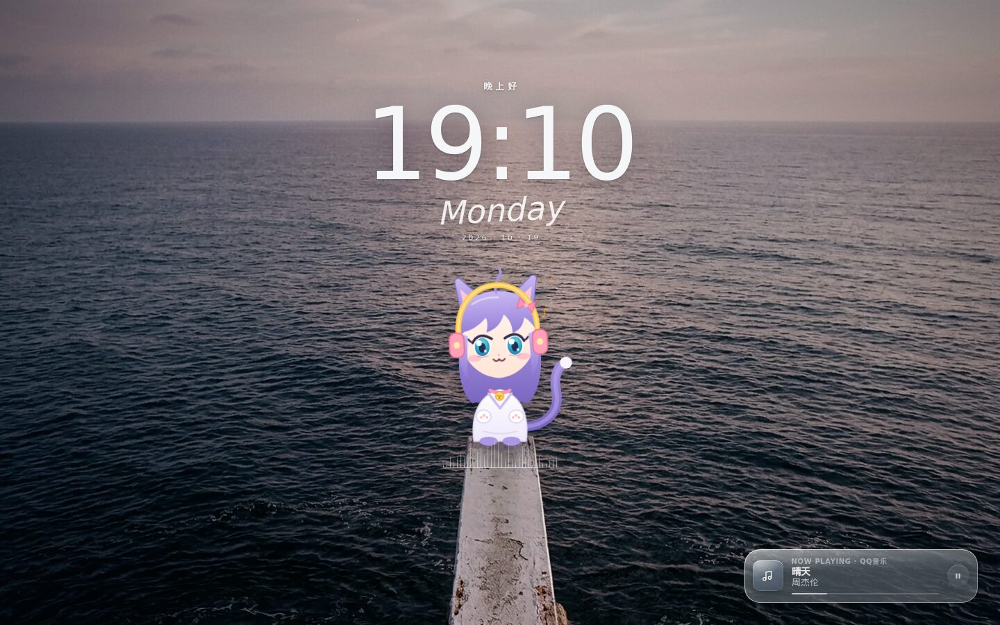

<div align="center">


# lingdot 灵点桌宠

**住在你桌面上的傲娇猫娘：帮你盯 AI 任务、陪你听歌、陪你聊天。**<br/>
**A tsundere catgirl that lives on your desktop: she watches your AI tasks, listens to music with you, and talks back.**

[](https://github.com/zengjieyun67-cell/lingdot-desktop-pet/releases/tag/build-12)


[](LICENSE)
[](https://github.com/zengjieyun67-cell/lingdot-desktop-pet/stargazers)

[中文](#中文) · [English](#english) · [下载 Download](#-下载--download)



<sub>桌面模式 ·「海」风格（截图使用内置 SVG 形象；导入你自己的 Live2D 模型后她会换成你的角色）<br/>Desktop mode, "Sea" style (shown with the built-in SVG character; import your own Live2D model to replace her)</sub>

</div>

---

<a id="中文"></a>

## ✨ 她能做什么

| | |
|---|---|
| 🐾 **桌宠模式** | 透明、无边框、始终置顶的小窗口，可拖动、可缩放（60%–250%），记住位置。呼吸、眨眼、耳朵抖动、尾巴摆动、眼睛跟随鼠标。 |
| 🌊 **桌面模式** | 一键把桌面变成「海」：大时钟、日历、天气、便签、正在播放，小喵站在跳台上；还有屏保模式，按时间自动切换清晨 / 白天 / 黄昏 / 夜晚。 |
| 🎭 **导入 Live2D** | 把你自己的 `.model3.json` 模型和 Cubism SDK 放进「下载」，打开应用自动识别导入；情绪和任务状态映射到模型的表情与动作。 |
| 🔔 **AI 任务提醒** | 配套 Chrome / Edge 扩展：ChatGPT 回答**生成完 / 出错 / 需要你操作**时，小喵会跳出来提醒你。只在你授权的网站运行，只上报状态信号，不读对话内容。 |
| 🎙️ **语音聊天（Mac）** | 长按她说话，或开启「实时对话」像打电话一样聊。用 macOS 自带语音识别和系统语音，免费。 |
| 💬 **AI 聊天** | 内置 DeepSeek 预设，粘贴 API Key 就能聊；也支持任意 OpenAI 兼容接口。Key 只存在系统钥匙串 / 凭据管理器里。 |
| 📝 **便签** | 玻璃质感便签：清单、置顶、提醒、浮动到桌面，`⌘⇧N` / `Ctrl+Shift+N` 随时新建。 |
| 🎧 **听歌 & 小情绪** | 检测 QQ音乐 / Apple 音乐 / Spotify / 网易云播放，戴上耳机跟着摇头；深夜催你睡觉，饭点提醒吃饭，被冷落会闹别扭，摸头会害羞。 |
| 🪟 **统一的玻璃界面** | 一套苹果风磨砂玻璃设计语言，面板、便签、快捷圆盘、桌面小组件风格一致，浅色 / 深色都好看。 |
| 🔒 **本地优先** | 记忆、好感度、聊天记录都只存在本机 SQLite；本地服务只监听 `127.0.0.1`，带令牌校验。 |

## 📸 截图

<table>
  <tr>
    <td align="center" width="33%"><br/><sub>任务 · 扩展引导 · 正在播放<br/>Tasks · extension guide · now playing</sub></td>
    <td align="center" width="33%"><br/><sub>便签（置顶 · 提醒 · 清单）<br/>Notes: pin, reminders, checklists</sub></td>
    <td align="center" width="33%"><br/><sub>一键导入你的 Live2D<br/>One-click Live2D import</sub></td>
  </tr>
  <tr>
    <td align="center"><br/><sub>右键快捷圆盘（中间按住说话）<br/>Right-click dial (hold mic to talk)</sub></td>
    <td align="center"><br/><sub>深色模式<br/>Dark mode</sub></td>
    <td align="center"><br/><sub>桌宠模式 · 听歌时戴上耳机<br/>Pet mode, listening to music</sub></td>
  </tr>
</table>

<table>
  <tr>
    <td align="center" width="50%"><br/><sub>桌面模式 · 夜晚 · Desktop mode at night</sub></td>
    <td align="center" width="50%"><br/><sub>屏保模式 · 黄昏 · Screensaver at dusk</sub></td>
  </tr>
</table>

<a id="-下载--download"></a>

## 📦 下载 · Download

最新版本 / Latest: **[build-12](https://github.com/zengjieyun67-cell/lingdot-desktop-pet/releases/tag/build-12)**

| 系统 · Platform | 文件 · File | 说明 · Notes |
|---|---|---|
| 🍎 macOS · Apple Silicon (M1–M4) | [lingdot-desktop-pet_0.1.0_aarch64.dmg](https://github.com/zengjieyun67-cell/lingdot-desktop-pet/releases/download/build-12/lingdot-desktop-pet_0.1.0_aarch64.dmg) | 推荐 · Recommended |
| 🍎 macOS · Intel | [lingdot-desktop-pet_0.1.0_x64.dmg](https://github.com/zengjieyun67-cell/lingdot-desktop-pet/releases/download/build-12/lingdot-desktop-pet_0.1.0_x64.dmg) | |
| 🪟 Windows 10 / 11 (x64) | [lingdot-desktop-pet_0.1.0_x64-setup.exe](https://github.com/zengjieyun67-cell/lingdot-desktop-pet/releases/download/build-12/lingdot-desktop-pet_0.1.0_x64-setup.exe) | 安装版，推荐 · Installer, recommended |
| 🪟 Windows 10 / 11 (x64) | [lingdot-desktop-pet_0.1.0_x64_en-US.msi](https://github.com/zengjieyun67-cell/lingdot-desktop-pet/releases/download/build-12/lingdot-desktop-pet_0.1.0_x64_en-US.msi) | MSI 安装包 · MSI package |
| 🪟 Windows 10 / 11 (x64) | [lingdot-desktop-pet_x64-portable.exe](https://github.com/zengjieyun67-cell/lingdot-desktop-pet/releases/download/build-12/lingdot-desktop-pet_x64-portable.exe) | 免安装，双击即用 · Portable, no install |
| 🧩 Chrome / Edge / Arc 扩展 | [browser-extension.zip](https://github.com/zengjieyun67-cell/lingdot-desktop-pet/releases/download/build-12/browser-extension.zip) | AI 任务提醒（可选）· AI-task alerts (optional) |

## 🚀 快速开始

**Mac**

1. 下载对应芯片的 `.dmg`，打开后把 **lingdot-desktop-pet** 拖进「应用程序」。
2. 应用没有付费签名，第一次请在「应用程序」里 **右键 → 打开 → 打开**。<br/>
   还是打不开：系统设置 → 隐私与安全性 → 「仍要打开」，或在终端运行 `xattr -dr com.apple.quarantine /Applications/lingdot-desktop-pet.app`。
3. 她是菜单栏应用，不在 Dock 里；菜单栏图标可以显示 / 隐藏、切换桌面模式、重置位置。

**Windows**

1. 双击 `-setup.exe`（或 `.msi`）安装；也可以直接运行免安装的 `portable.exe`。
2. SmartScreen 提示「Windows 已保护你的电脑」时，点 **更多信息 → 仍要运行**（未签名应用的正常提示）。缺 WebView2 时安装程序会自动下载。
3. 如果 exe 被杀毒软件删掉：Windows 安全中心 → 保护历史记录 → 还原 / 允许。

**和她互动**：单击打开面板 · 拖动移动 · 右键打开快捷圆盘 · 在头上来回轻扫是摸头 · 按住 `⌘` / `Ctrl` 滚轮调大小。

**（可选）AI 任务提醒**：解压 `browser-extension.zip` → `chrome://extensions` 打开「开发者模式」→「加载已解压的扩展程序」→ 在小喵面板「任务」页复制配对码，粘贴到扩展设置 → 给 ChatGPT 点「授权」。

## 🎭 使用你自己的 Live2D 模型

> ⚠️ 本仓库和安装包 **不包含** 任何 Live2D 模型，也不包含 Live2D Cubism Core（`live2dcubismcore.min.js`）。它们受各自许可保护，需要你自己获取。

1. 在 [Live2D 官网](https://www.live2d.com/en/sdk/download/web/) 同意许可后下载 **Cubism SDK for Web**（`CubismSdkForWeb-*.zip`）。
2. 准备一个你有权使用的 Live2D 模型（文件夹里有 `.model3.json`、`.moc3` 和贴图），请遵守模型作者的条款。
3. 把 SDK 的 zip 和模型文件夹放进「下载」（或桌面 / 文稿 / `~/Live2D`），打开应用会自动导入；没找到就去 **设置 → 角色 → 一键导入我的 Live2D / 选择模型文件夹**。
4. Windows 免安装版：把模型文件夹和 `live2dcubismcore.min.js` 放在 exe 旁边，首次启动自动导入。
5. 看不到形象？设置页「当前：」一行会显示原因，随时可以切回内置猫娘。

## 🛠️ 从源码构建

需要 Rust（rustup）、Node.js ≥ 20、pnpm ≥ 9；Mac 还需要 Xcode Command Line Tools。

```bash
git clone https://github.com/zengjieyun67-cell/lingdot-desktop-pet.git
cd lingdot-desktop-pet
pnpm install
pnpm -r test && pnpm test:rust                       # 测试 · tests
pnpm build:extension                                 # 浏览器扩展 → apps/browser-extension/dist
pnpm build:desktop                                   # 桌面应用 → src-tauri/target/release/bundle/
```

- 只看界面不装 Rust：`pnpm --filter @desktop-pet/desktop dev`，浏览器打开 `http://localhost:1420/?skipFirstRun=1#/panel`（mock 数据）。
- Mac 懒人包：双击 `一键安装.command`，自动装好依赖并打出 `.dmg`（内置国内镜像）。
- 没有编译环境：Fork 后在 Actions 运行 *Build macOS DMG + Windows installer*，直接下载安装包。
- 技术栈：Tauri 2 · React + TypeScript + Vite · Rust（`pet-core`：状态机、SQLite、本地服务）· Chrome MV3 扩展。

完整说明（目录结构、状态机、性格与记忆、隐私设计、已知限制）见 **[docs/GUIDE.md](docs/GUIDE.md)**。

## 📝 更新日志

- **build-12**：桌面模式下猫娘视线跟随全局鼠标（支持 Retina、多显示器，闲置自动回正）；修复首次进入桌面模式只占半屏；屏保窗口尺寸同步修复。
- **build-11**：Mac 自动导入 `.app` 内或旁边的 `live2d-pack` 模型。
- **build-10**：桌面模式切换提速；修复 Windows 模型路径与长路径；统一玻璃面板；修复拖动吞掉点击。

## 🗺️ 路线图

- [x] 桌宠模式 / 桌面模式 / 屏保，统一玻璃界面
- [x] Live2D 自动导入，ChatGPT 任务提醒，DeepSeek 聊天
- [x] Mac 语音聊天、听歌检测；Windows 安装版 + 免安装版
- [ ] 更多网站适配：哔哩哔哩、CapCut 等
- [ ] Windows 语音识别与听歌检测
- [ ] Live2D 动作映射编辑器、自定义台词包
- [ ] 代码签名 / 公证、自动更新；Firefox / Safari 扩展

## 🤝 参与贡献

非常欢迎 Issue 和 PR！

- 🐛 遇到问题：[提一个 Issue](https://github.com/zengjieyun67-cell/lingdot-desktop-pet/issues)，附上系统版本和截图。
- 💡 想要新功能 / 新网站适配：适配器写法见 `apps/browser-extension/ADAPTERS.md`。
- 🎨 设计、台词、翻译同样欢迎。
- 提交前请跑一遍 `pnpm -r test` 和 `pnpm test:rust`；**不要提交任何 Live2D 模型或 Cubism Core 文件**。

如果她让你的桌面可爱了一点，点个 ⭐ Star 就是最大的支持！

## 📄 许可证

源码以 [MIT License](LICENSE) 开源。Live2D Cubism Core 和第三方 Live2D 模型不在本仓库中，也不适用 MIT 许可，请遵守它们各自的条款。

---

<a id="english"></a>

## English

**lingdot** is a cross-platform desktop pet (macOS + Windows) built with Tauri 2, React and Rust. A tsundere catgirl sits on your desktop, reacts to your AI tasks, chats with you and keeps you company.

### Features

- 🐾 **Pet mode**: a transparent, frameless, always-on-top companion. Drag her anywhere, resize her from 60% to 250%, and she remembers where you left her. She breathes, blinks, flicks her ears, swishes her tail and follows your cursor.
- 🌊 **Desktop mode**: turns your desktop into the "Sea" scene with a big clock, calendar, weather, notes and a now-playing card. It includes a screensaver and lighting that shifts with the time of day.
- 🎭 **Live2D import**: drop your own `.model3.json` model and the Cubism SDK zip into Downloads, and the app finds and imports them. Moods and task states map to your model's expressions and motions.
- 🔔 **AI-task notifications**: a companion Chrome/Edge extension tells her when a ChatGPT answer is done, has failed or needs your input. It runs only on sites you approve and reports state signals only, never your conversations.
- 🎙️ **Voice chat (Mac)**: hold the pet to talk, or turn on hands-free real-time mode. It uses macOS's built-in speech recognition and voices, so it's free.
- 💬 **AI chat**: a DeepSeek preset (just paste a key) or any OpenAI-compatible endpoint. Keys stay in the macOS Keychain or Windows Credential Manager.
- 📝 **Notes**: glass sticky notes with checklists, pinning and reminders. You can float them on the desktop, and `⌘⇧N` / `Ctrl+Shift+N` makes a new one from anywhere.
- 🎧 **Music & moods**: she puts on headphones when QQ Music, Apple Music, Spotify or NetEase is playing. She also nags you to sleep late at night, sulks when ignored and blushes when you pat her head.
- 🪟 **One glass UI**: a single Apple-style frosted-glass design language across every panel, note, dial and widget, in light and dark.
- 🔒 **Local-first**: memory, affinity and chat history stay in local SQLite. The local server listens on `127.0.0.1` only and checks a token.

### Download

Get the latest build from **[Releases › build-12](https://github.com/zengjieyun67-cell/lingdot-desktop-pet/releases/tag/build-12)** (see the [download table](#-下载--download) above): `.dmg` for Apple Silicon or Intel Macs, `-setup.exe` / `.msi` / portable `.exe` for Windows x64, and `browser-extension.zip` for AI-task alerts.

### Quick start

- **macOS**: open the `.dmg` and drag the app into Applications. The app is unsigned, so the first time you open it, **right-click → Open → Open**. You can also go to System Settings → Privacy & Security → "Open Anyway", or run `xattr -dr com.apple.quarantine /Applications/lingdot-desktop-pet.app`. She lives in the menu bar, not the Dock.
- **Windows**: run the `-setup.exe` or `.msi`, or just double-click the portable `.exe`. If SmartScreen says "Windows protected your PC", click **More info → Run anyway**. If your antivirus removes the exe, restore it from Windows Security → Protection history.
- **Interact**: click to open the panel, drag to move her, right-click for the quick dial, stroke her head to pat her, and hold `⌘`/`Ctrl` and scroll to resize her.
- **Extension (optional)**: unzip `browser-extension.zip`, open `chrome://extensions`, turn on Developer mode and click "Load unpacked". Then copy the pairing code from the pet's Tasks tab into the extension's settings and authorize ChatGPT.

### Bring your own Live2D model

> ⚠️ This repo and the release builds include **no** Live2D models and **no** Live2D Cubism Core (`live2dcubismcore.min.js`). Both are licensed separately, so you need to get them yourself.

1. Download **Cubism SDK for Web** from the [Live2D website](https://www.live2d.com/en/sdk/download/web/) after accepting its license.
2. Get a Live2D model you're allowed to use: a folder with `.model3.json`, `.moc3` and textures. Follow the model author's terms.
3. Put the SDK zip and the model folder in Downloads (or Desktop, Documents or `~/Live2D`) and launch the app. If nothing is found, use **设置 (Settings) → 角色 (Character) → 一键导入我的 Live2D / 选择模型文件夹**.
4. Windows portable: place the model folder and `live2dcubismcore.min.js` next to the exe.

### Build from source

```bash
git clone https://github.com/zengjieyun67-cell/lingdot-desktop-pet.git
cd lingdot-desktop-pet
pnpm install
pnpm -r test && pnpm test:rust
pnpm build:extension
pnpm build:desktop
```

Requirements: Rust (rustup), Node.js ≥ 20, pnpm ≥ 9, and Xcode Command Line Tools on macOS. To preview the UI without Rust, run `pnpm --filter @desktop-pet/desktop dev` and open `http://localhost:1420/?skipFirstRun=1#/panel`. You can also fork the repo and run the *Build macOS DMG + Windows installer* workflow in Actions. Full developer docs (in Chinese): [docs/GUIDE.md](docs/GUIDE.md).

### Changelog

- **build-12**: in desktop mode her gaze follows the global cursor (Retina and multi-monitor aware, eases back to centre when idle); fixed desktop mode filling only half the screen on first open; same sizing fix for the screensaver.
- **build-11**: Mac auto-imports a `live2d-pack` model from inside or next to the `.app`.
- **build-10**: faster desktop-mode switching; fixed Windows model paths and long paths; unified glass panels; dragging no longer swallows clicks.

### Roadmap

- [x] Pet mode, desktop mode and screensaver with one glass UI
- [x] Live2D auto-import, ChatGPT task alerts, DeepSeek chat
- [x] Voice chat and music detection on Mac; Windows installer and portable build
- [ ] More site adapters (Bilibili, CapCut, …)
- [ ] Speech recognition and music detection on Windows
- [ ] Live2D motion-mapping editor and custom line packs
- [ ] Code signing and notarization, auto-update, Firefox and Safari extensions

### Contributing

Issues and PRs are very welcome: bug reports, new site adapters (see `apps/browser-extension/ADAPTERS.md`), design, dialogue lines and translations. Please run `pnpm -r test` and `pnpm test:rust` before opening a PR, and **never commit Live2D models or Cubism Core files**.

If she made your desktop a little cuter, a ⭐ star means a lot!

### License

The source code is released under the [MIT License](LICENSE). Live2D Cubism Core and third-party Live2D models are not part of this repository and are not covered by MIT; follow their own licenses.
